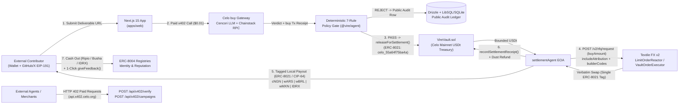

# Vire — Autonomous Proof-of-Work & Multi-Corridor FX Settlement Agent (Celo Mainnet)

Vire is an autonomous proof-of-work and commission settlement agent built for a Nigerian gadget retail launch partner and cross-border remote teams that verifies off-chain deliverables (promo posts, verified referrals, QA bug reports, and localization tasks), converts exact-output USD₮ into local stablecoins (`cNGN`, `wARS`, `wBRL`, `wMXN`, `IDRX`) on Textile FX, and settles directly to external contributors on Celo Mainnet (`42220`). It replaces hours of manual deliverable checking, spreadsheets, and 4–8% multi-hop FX/bank fees with a single auditable onchain settlement loop funded from one USD₮ treasury.

---

## Architecture



---

## Verified Celo Mainnet (42220) Contracts & Token Decimals

Every token decimal is read strictly from `@vire/shared` and verified onchain by `npm run doctor`. Never assume 18 decimals (`IDRX` uses **2 decimals only**).

| Asset / Contract | Celo Mainnet Address (`42220`) | Decimals | Role |
|---|---|:---:|---|
| **VireVault (Treasury)** | `0x86140c2aFd04c9dEC2AB71EA74953Bce70C5a9BF` | — | Policy-guarded USD₮ vault ([Blockscout verified](https://celo.blockscout.com/address/0x86140c2afd04c9dec2ab71ea74953bce70c5a9bf)) |
| **USD₮** | `0x48065fbBE25f71C9282ddf5e1cD6D6A887483D5e` | **6** | Treasury & Textile sell leg |
| **USD₮ FeeCurrency Adapter** | `0x0E2A3e05bc9A16F5292A6170456A710cb89C6f72` | 18 (gas) | CIP-64 gas-in-USD₮ `feeCurrency` |
| **USDC** | `0xcebA9300f2b948710d2653dD7B07f33A8B32118C` | **6** | x402 reference asset |
| **cNGN** (Nigeria) | `0xF6829D7393dAe24509eb1E52eE8e572e2E271a4f` | **6** | Launch partner retail affiliate payouts |
| **IDRX** (Indonesia) | `0x18Bc5bcC660cf2B9cE3cd51a404aFe1a0cBD3C22` | **2** | APAC localization payouts (**2 decimals only**) |
| **wARS** (Argentina) | `0x0DC4F92879B7670e5f4e4e6e3c801D229129D90D` | **18** | LatAm QA bounties (zero-fee Ripio ramp) |
| **wBRL** (Brazil) | `0xD76f5Faf6888e24D9F04Bf92a0c8B921FE4390e0` | **18** | PT-BR localization (zero-fee Ripio ramp) |
| **wMXN** (Mexico) | `0x337E7456B420bD3481e7FA61fA9850343d610d34` | **18** | LatAm referrals (zero-fee Ripio ramp) |
| **wCOP** (Colombia) | `0x8a1D45e102e886510e891d2Ec656a708991e2D76` | **18** | Colombia corridor (interbank hours) |
| **Textile LimitOrderReactor** | `0xa9AA0a64769cBed4d3B1Ceb4Df01CdE915C235b3` | — | Textile FX settlement reactor |
| **Textile VaultOrderExecutor** | `0x01b006d5c687bde182aa36F542f1f014144742e2` | — | Textile FX operator vault executor |
| **ERC-8004 Identity Registry** | `0x8004A169FB4a3325136EB29fA0ceB6D2e539a432` | — | Agent NFT identity |
| **ERC-8004 Reputation Registry** | `0x8004BAa17C55a88189AE136b182e5fdA19dE9b63` | — | Contributor feedback (`tag: settlement`) |

---

## Monorepo Layout

```text
vire/
├── contracts/          # Foundry: VireVault.sol, unit/fuzz/invariant tests, Celo Mainnet deploy script
├── packages/
│   ├── shared/         # Canonical token/decimals registry, Ripio/cNGN/IDRX ramp builders, partner config, ABIs
│   ├── celo-infra/     # sendTaggedTx() (ERC-8021), CIP-64 fee abstraction, ERC-8004 client, Celo `buy` client
│   ├── textile/        # Textile FX RFQ v2 client (exact-output buyAmount, 75s+ timeout, max-4 semaphore, cancel/submit)
│   └── agent/          # SSRF-guarded artifact fetcher, paid `buy` verifier, 7-rule Policy Gate, SettlementOrchestrator
├── apps/web/           # Next.js 15 App Router, Drizzle + LibSQL/SQLite, @x402/next paid endpoints, Public Audit Ledger
└── scripts/            # doctor.ts (`npm run doctor`), register-agent.ts, seed-campaigns.ts
```

---

## Judge Quickstart & Verification Walkthrough

**Live Production App**: https://usevire.xyz  
**ERC-8004 Agent ID**: `#10116` ([Registration Tx on Celoscan](https://celoscan.io/tx/0x27bbf093c2ce4348e2322088b73ecc9fcd8bcae69ddfeecb3f7c7ccfbc7da704))  
**ERC-8004 Agent Manifest**: https://usevire.xyz/api/agent-card.json  
**Public Live Audit Ledger**: https://usevire.xyz/ledger

### 1. Install, Build & Run All Automated Tests

```bash
pnpm install
pnpm build
pnpm typecheck
pnpm test
forge install --root contracts --no-git foundry-rs/forge-std OpenZeppelin/openzeppelin-contracts
pnpm test:contracts   # Foundry unit + 256-run fuzz + 2,048-call stateful invariant suite
```

### 2. Run Non-Destructive Live Celo Mainnet Diagnostics (`npm run doctor`)

```bash
npm run doctor
```

Verifies live against Celo Mainnet (`42220`):
- RPC chain ID `42220` & head block
- Onchain `decimals()` across all 8 listed tokens (asserting `IDRX === 2`, `cNGN === 6`, `USD₮ === 6`, `wFIAT === 18`) + `USD₮ FeeCurrency Adapter`
- `VireVault` bytecode, owner/agent role separation, pause status, and live USD₮ balance
- ERC-8004 Identity ownership & Reputation summary (`tag = "settlement"`)
- Live Textile FX v2 `POST /v2/rfq/preview` quotes across `cNGN`, `wARS`, `wBRL`, `wMXN`, and `IDRX`
- Live Celo `buy` catalog (`cencori.v1.chat.completions` & `chainstack.celo`)
- Live Celo hosted x402 facilitator (`https://api.x402.celo.org/supported`) & `/api/x402/verify` HTTP `402` challenge
- Programmatic ERC-8021 verification (`verifyTx()`) for attribution code `celo_55a64f75ba4a`

### 3. Start Locally & Inspect the App

```bash
cp .env.example .env
pnpm seed
pnpm dev
```

Visit:
- **`/`** — Mission Control, live Textile FX corridor strip, Named Launch Partner spotlight
- **`/campaigns`** — Multi-stage repeat missions (`Stage 1 → 2 → 3`) with onchain policy guardrails
- **`/claim`** — Contributor wallet connect, EIP-191 / GitHub identity bind, live 5-step verification & settlement pipeline, Ripio/cNGN/IDRX cash-out package, and 1-click ERC-8004 `giveFeedback()`
- **`/ledger`** — Public Live Settlement & Audit Ledger (Completed Settlements, Rejected Policy Gate Claims, Paid `buy` Receipts, and x402 PayTo Inflows)
- **`/console`** — Live `VireVault` inspector and interactive `POST /api/x402/verify` HTTP 402 playground

---

## Mainnet Deployment Runbook (Celo 42220)

1. **Configure `.env`** using `.env.example` (keep `VIRE_OWNER_PRIVATE_KEY` and `VIRE_AGENT_PRIVATE_KEY` strictly separate, set `TEXTILE_API_KEY`, `X402_API_KEY`, `VIRE_X402_PAY_TO`, `TEAM_WALLET_BLOCKLIST`, and your Launch Partner `NEXT_PUBLIC_PARTNER_*` values).
2. **Deploy & Verify `VireVault.sol` on Celo Mainnet**:
   ```bash
   export VIRE_SETTLEMENT_AGENT_ADDRESS=<your-agent-eoa>
   forge script contracts/script/DeployVireVault.s.sol:DeployVireVault \
     --root contracts --rpc-url https://forno.celo.org --broadcast --verify
   ```
3. **Register ERC-8004 Identity** (from `VIRE_AGENT_PRIVATE_KEY`, tagged with `celo_55a64f75ba4a`):
   ```bash
   pnpm register-agent
   # Add printed VIRE_AGENT_ID=<id> to .env and redeploy
   ```
4. **Seed Campaigns & Fund on `VireVault`**:
   ```bash
   pnpm seed
   # Approve USDt and call VireVault.createCampaign(...) for each printed bytes32 campaignId
   ```
5. **Confirm Production Readiness**:
   ```bash
   npm run doctor
   ```

---

## Security & Track Guardrails

- **No double-tagging**: Textile swaps are broadcast strictly via `createUntaggedTextileWalletClient()` with Textile's native `includeAttribution: true` + `builderCodes: ["celo_55a64f75ba4a"]`. All non-Textile txs (`VireVault`, local payouts, ERC-8004) go through `sendTaggedTx()` (`@celo/attribution-tags`).
- **No self-trading / external recipients only**: Enforced both in `VireVault.sol` (`recipient != settlementAgent && recipient != owner()`) and in the Policy Gate (`TEAM_WALLET_BLOCKLIST`).
- **Custody separation**: Compromised LLM outputs or prompt injections can never drain funds beyond `maxPerPayoutUsdt`, rolling 24h `dailyLimitUsdt`, `maxPayoutsPerRecipient`, and `remainingBudget`. `claimToken` is persisted server-side only and never returned by any public endpoint.
