# Vire

**Programmable Local-Currency Settlement & Multi-Corridor FX Protocol on Celo Mainnet**

[Live App](https://usevire.xyz) · [Public Settlement Ledger](https://usevire.xyz/ledger) · [VireVault v2 on Celoscan](https://celoscan.io/address/0x8969060F1605A6C351210323169Efb226667b26f) · [ERC-8004 Agent Manifest](https://usevire.xyz/api/agent-card.json)

---

**Vire** turns a single onchain stablecoin treasury into instant, exact-output local-currency payouts across emerging markets on **Celo Mainnet (`42220`)**.

Merchants, protocols, and global teams routinely fund budgets in USD stablecoins (`USD₮` / `USDC`) or native tokens, while customers, promoters, and remote contributors across Africa, Latin America, and Southeast Asia need exact local currency (`cNGN`, `wARS`, `wBRL`, `wMXN`, `IDRX`, `wCOP`) in their own wallets and bank accounts — without 4–8% FX/wire spreads, multi-day bank delays, manual spreadsheets, or handing treasury custody to an automated bot.

Vire closes that corridor end to end in a single auditable onchain loop:

1. **Fund Once, Non-Custodially**: Any wallet or multisig creates a campaign on [usevire.xyz/create](https://usevire.xyz/create) using any of **8 liquid Celo tokens** (`USD₮`, `USDC`, `CELO`, `cNGN`, `wARS`, `wBRL`, `wMXN`, `IDRX`). Non-`USD₮` deposits auto-convert into `USD₮` via Textile FX and lock inside **`VireVault v2`** under deterministic onchain spending caps. Campaign creators retain exclusive custody to pause, adjust limits, or withdraw unspent funds at any time — even while the vault is paused.
2. **Verify Automatically or Issue Vouchers**: Creators choose the payout trigger that fits their business — **Autonomous AI Verification** (paid Celo `buy` inference + deterministic 7-rule Policy Gate), **Single-Use Cashback Vouchers** (cryptographically hashed codes with order/GMV tracking via `/manage`), or **Manual Creator Approval**.
3. **Clear Exact Local Currency via Textile FX v2**: Once verified, `VireVault` releases bounded `USD₮` to Vire's settlement agent, which executes an **exact-output (`buyAmount`)** request-for-quote against live **Textile FX v2** market makers, delivers the exact promised local stablecoin amount in one Celo block, records an immutable onchain settlement receipt, and refunds any unused `USD₮` dust back into the campaign budget.
4. **Zero-Friction Onboarding & Last-Mile Cash-Out**: Recipients sign in natively via **Opera MiniPay** (`window.ethereum.isMiniPay`) or **Privy** (`Google`, `Email`, `X`, `WalletConnect`, `MetaMask`, `Rabby`, `Valora`), receive **`0.25 CELO` launch gas sponsorship** on first payout, and cash out straight to local banks — via **1-click in-app local-to-`USD₮` Textile FX conversion** for MiniPay bank transfers (OPay, PalmPay, Moniepoint), prefilled **zero-fee Ripio off-ramps** (ARS, BRL, MXN, COP), or **1:1 IDRX redemption** (IDR).

---

## Live Stablecoin Corridors (Celo Mainnet `42220`)

Every payout settles directly on Celo Mainnet against live **Textile FX v2** liquidity using exact-output (`buyAmount`) quotes so recipients never absorb FX slippage. Token decimals are strictly enforced from `@vire/shared` and asserted onchain by `npm run doctor` (note: **`IDRX` uses 2 decimals only**).

| Corridor | Asset | Region | Decimals | FX Clearing Rail | Last-Mile Cash-Out Rail |
|---|---|---|:---:|---|---|
| **Nigeria** | `cNGN` | Africa | `6` | Textile FX v2 (`USD₮ → cNGN`) | In-app 1-click `cNGN → USD₮` Textile swap → **Opera MiniPay** bank transfer (OPay, PalmPay, Moniepoint) or Celo-enabled NGN exchanges (Quidax, Busha, Yellow Card) |
| **Argentina** | `wARS` | LatAm | `18` | Textile FX v2 (`USD₮ → wARS`) | Prefilled zero-fee **Ripio Ramp** (`Celo 42220 → ARS` CBU/CVU) |
| **Brazil** | `wBRL` | LatAm | `18` | Textile FX v2 (`USD₮ → wBRL`) | Prefilled zero-fee **Ripio Ramp** (`Celo 42220 → BRL` PIX) |
| **Mexico** | `wMXN` | LatAm | `18` | Textile FX v2 (`USD₮ → wMXN`) | Prefilled zero-fee **Ripio Ramp** (`Celo 42220 → MXN` CLABE) |
| **Indonesia** | `IDRX` | Southeast Asia | **`2`** | Textile FX v2 (`USD₮ → IDRX`) | 1:1 **IDRX** official IDR bank redemption portal |
| **Colombia** | `wCOP` | LatAm | `18` | Textile FX v2 (`USD₮ → wCOP`, interbank hours) | Prefilled zero-fee **Ripio Ramp** (`Celo 42220 → COP`) |

**Multi-Token Campaign Funding**: Campaign creators can fund `VireVault v2` budgets using `USD₮`, `USDC`, `CELO`, `cNGN`, `wARS`, `wBRL`, `wMXN`, or `IDRX`. Non-`USD₮` funding legs automatically clear into `USD₮` via Textile FX before depositing into the campaign's isolated onchain budget.

---

## Verification & Payout Modes

| Mode | Ideal For | How It Works |
|---|---|---|
| **Single-Use Cashback Vouchers (`voucher`)** | Retail e-commerce cashback, point-of-sale rewards, partner promotions | Merchants issue cryptographically hashed single-use codes from `/manage` with order/GMV tracking. Buyers visit `/c/[slug]`, sign in with Google or MiniPay, enter their code, and receive exact local currency immediately. |
| **Autonomous Proof-of-Work (`auto_ai`)** | Open-source QA bug bounties, localization sprints, affiliate & creator deliverables | Contributors bind GitHub/X via EIP-191 and submit deliverable URLs. Vire fetches artifacts through an SSRF-guarded pipeline, runs paid Celo `buy` LLM/RPC verification, evaluates a deterministic 7-rule Policy Gate, and settles automatically. |
| **Manual Creator Review (`manual`)** | High-value grants, curated vendor invoices, bespoke agency work | Creators review submissions in `/manage` and execute 1-click exact-output Textile FX settlement directly from their campaign budget. |

---

## Protocol Architecture

```mermaid
flowchart LR
    ORG["Campaign Creator<br/>(/create · /manage)"] -->|"Fund in 8 Celo Tokens<br/>(Auto-Swap to USDt)"| VAULT["VireVault v2<br/>(Non-Custodial USDt Treasury)"]
    USER["Recipient / Buyer<br/>(MiniPay · Privy · EIP-191)"] -->|"Submit Deliverable URL<br/>or Single-Use Voucher"| WEB["Next.js 15 App<br/>(apps/web)"]
    WEB -->|"AI Mode: Paid x402 Call ($0.01)"| BUY["Celo buy Gateway<br/>(Cencori LLM + Chainstack RPC)"]
    BUY -->|"Verdict + Receipt"| GATE["Deterministic 7-Rule<br/>Policy Gate (@vire/agent)"]
    WEB -->|"Voucher Hash Check<br/>or Creator Approval"| GATE
    GATE -->|"Reject -> Audit Row"| DB[("Drizzle + LibSQL/SQLite<br/>Public Audit Ledger")]
    GATE -->|"Pass -> releaseForSettlement()<br/>(ERC-8021: celo_55a64f75ba4a)"| VAULT
    VAULT -->|"Bounded USDt"| AGENT["settlementAgent EOA"]
    AGENT -->|"POST /v2/rfq/request (buyAmount)<br/>includeAttribution + builderCodes"| TEXTILE["Textile FX v2<br/>(LimitOrderReactor / VaultOrderExecutor)"]
    TEXTILE -->|"Exact Local Stablecoins"| AGENT
    AGENT -->|"Tagged Local Payout + 0.25 CELO Gas<br/>(cNGN · wARS · wBRL · wMXN · IDRX · wCOP)"| USER
    AGENT -->|"recordSettlementReceipt() + Dust Refund"| VAULT
    USER -->|"1-Click Local->USDt Swap (MiniPay)<br/>Ripio / IDRX Cash-Out + giveFeedback()"| ERC8004["ERC-8004 Registries<br/>(Agent #10116 Identity & Reputation)"]
    EXT["External Agents & Apps"] -->|"HTTP 402 Paid Requests<br/>(api.x402.celo.org)"| X402["POST /api/x402/verify<br/>POST /api/x402/campaigns"]
```



---

## Verified Celo Mainnet (`42220`) Contracts & Registry

All contracts and token decimals are read from `@vire/shared` and verified live against Celo Mainnet RPC by `npm run doctor`.

| Component / Asset | Celo Mainnet Address (`42220`) | Decimals | Role |
|---|---|:---:|---|
| **VireVault v2 (Treasury)** | `0x8969060F1605A6C351210323169Efb226667b26f` | — | Non-custodial multi-tenant USD₮ vault ([Celoscan](https://celoscan.io/address/0x8969060F1605A6C351210323169Efb226667b26f) · [Deploy Tx](https://celoscan.io/tx/0x4e6e4837f1210a76db42c553f050b882c232a8adb692f475b04bdc4343507050)) |
| **Settlement Agent EOA** | `0x8ba43426D57E55C51c4fe7C4F8a68Df3bf008089` | — | Bounded Textile FX taker & payout executor (strictly separated from vault owner & campaign creators) |
| **USD₮** | `0x48065fbBE25f71C9282ddf5e1cD6D6A887483D5e` | `6` | Treasury accounting & Textile FX sell leg |
| **USD₮ FeeCurrency Adapter** | `0x0E2A3e05bc9A16F5292A6170456A710cb89C6f72` | `18` (gas) | CIP-64 gas abstraction in USD₮ |
| **USDC** | `0xcebA9300f2b948710d2653dD7B07f33A8B32118C` | `6` | Multi-token funding & x402 reference asset |
| **USDC FeeCurrency Adapter** | `0x2F25deB3848C207fc8E0c34035B3Ba7fC157602B` | `18` (gas) | CIP-64 gas abstraction in USDC |
| **cNGN** (Nigeria) | `0xF6829D7393dAe24509eb1E52eE8e572e2E271a4f` | `6` | Compliant Naira settlement corridor |
| **IDRX** (Indonesia) | `0x18Bc5bcC660cf2B9cE3cd51a404aFe1a0cBD3C22` | **`2`** | Indonesian Rupiah settlement corridor (**2 decimals only**) |
| **wARS** (Argentina) | `0x0DC4F92879B7670e5f4e4e6e3c801D229129D90D` | `18` | Argentine Peso settlement corridor (Ripio zero-fee ramp) |
| **wBRL** (Brazil) | `0xD76f5Faf6888e24D9F04Bf92a0c8B921FE4390e0` | `18` | Brazilian Real settlement corridor (Ripio zero-fee ramp) |
| **wMXN** (Mexico) | `0x337E7456B420bD3481e7FA61fA9850343d610d34` | `18` | Mexican Peso settlement corridor (Ripio zero-fee ramp) |
| **wCOP** (Colombia) | `0x8a1D45e102e886510e891d2Ec656a708991e2D76` | `18` | Colombian Peso settlement corridor (interbank hours) |
| **Textile LimitOrderReactor** | `0xa9AA0a64769cBed4d3B1Ceb4Df01CdE915C235b3` | — | Allowlisted Textile FX v2 settlement reactor |
| **Textile VaultOrderExecutor** | `0x01b006d5c687bde182aa36F542f1f014144742e2` | — | Allowlisted Textile FX v2 operator vault executor |
| **ERC-8004 Identity Registry** | `0x8004A169FB4a3325136EB29fA0ceB6D2e539a432` | — | Onchain agent identity NFT (`Agent #10116`, [Registration Tx](https://celoscan.io/tx/0x27bbf093c2ce4348e2322088b73ecc9fcd8bcae69ddfeecb3f7c7ccfbc7da704)) |
| **ERC-8004 Reputation Registry** | `0x8004BAa17C55a88189AE136b182e5fdA19dE9b63` | — | Verifiable recipient settlement ratings (`tag: settlement`) |

---

## Application Surface

| Route | Purpose |
|---|---|
| `/` | Protocol overview, live Textile FX liquidity & corridor rates, onchain vault telemetry, and verifiable source code viewer |
| `/create` | Self-serve campaign studio: configure corridor, verification mode (`voucher`, `auto_ai`, `manual`), spending caps, and fund in any of 8 Celo tokens directly into `VireVault v2` |
| `/manage` | Creator workspace: issue single-use cashback vouchers, track GMV & claim status, approve manual submissions, top up budgets, adjust caps, pause, or withdraw unspent `USD₮` |
| `/campaigns` | Directory of live active campaigns synced directly to onchain `VireVault v2` balances |
| `/c/[slug]` | Branded shareable claim page for individual merchant or protocol campaigns |
| `/claim` | Full contributor & voucher claim flow (MiniPay / Privy sign-in, EIP-191 binding, live 5-step Textile FX settlement, 1-click `cNGN → USD₮` swap, bank off-ramps, and ERC-8004 feedback) |
| `/ledger` | Public real-time settlement & audit ledger (completed payouts, rejected claims, `buy` verification receipts, and x402 inflows with Celoscan links) |
| `/console` | Live `VireVault v2` state inspector and interactive `POST /api/x402/verify` HTTP `402` playground |
| `/api/agent-card.json` | Machine-readable ERC-8004 Agent `#10116` manifest |
| `/api/x402/verify` & `/api/x402/campaigns` | HTTP `402` machine-payable verification and campaign discovery endpoints backed by `https://api.x402.celo.org` |

---

## Monorepo Layout

```text
vire/
├── contracts/          # Foundry: VireVault.sol (v2), unit/fuzz/invariant test suites, Celo Mainnet deploy script
├── packages/
│   ├── shared/         # Canonical token/decimals registry, 6 corridor configs, Ripio/MiniPay/IDRX off-ramp builders, ABIs
│   ├── celo-infra/     # sendTaggedTx() (ERC-8021), CIP-64 fee abstraction, ERC-8004 client, Celo `buy` client
│   ├── textile/        # Textile FX v2 RFQ client (exact-output buyAmount, 75s+ timeout, max-4 concurrency semaphore, cancel/submit)
│   └── agent/          # SSRF-guarded artifact fetcher, paid `buy` verifier, deterministic 7-rule Policy Gate, SettlementOrchestrator
├── apps/web/           # Next.js 15 App Router, Drizzle + LibSQL/SQLite, Privy + MiniPay, @x402/next endpoints, Audit Ledger
└── scripts/            # doctor.ts (`npm run doctor`), register-agent.ts, seed-campaigns.ts
```

---

## Quickstart & Live Verification

**Production App**: https://usevire.xyz  
**Public Settlement Ledger**: https://usevire.xyz/ledger  
**ERC-8004 Agent `#10116`**: [Manifest JSON](https://usevire.xyz/api/agent-card.json) · [Onchain Registration](https://celoscan.io/tx/0x27bbf093c2ce4348e2322088b73ecc9fcd8bcae69ddfeecb3f7c7ccfbc7da704)

### 1. Install, Build & Run Automated Test Suites

```bash
pnpm install
pnpm build
pnpm typecheck
pnpm test
forge install --root contracts --no-git foundry-rs/forge-std OpenZeppelin/openzeppelin-contracts
pnpm test:contracts   # Foundry unit + 256-run fuzz + 2,048-call stateful invariant suite
```

### 2. Run Non-Destructive Live Celo Mainnet Diagnostics

```bash
npm run doctor
```

Executes read-only verification directly against Celo Mainnet (`42220`):
- Celo RPC connectivity (`chainId === 42220`) and current head block
- Onchain `decimals()` across all 8 registered tokens (asserting `IDRX === 2`, `cNGN === 6`, `USD₮ === 6`, `wFIAT === 18`) and CIP-64 `USD₮ FeeCurrency Adapter`
- `VireVault v2` bytecode, owner/agent role separation, pause status, and live `USD₮` treasury balance
- ERC-8004 Agent `#10116` ownership and live Reputation Registry summary (`tag = "settlement"`)
- Live Textile FX v2 `POST /v2/rfq/preview` quotes across `cNGN`, `wARS`, `wBRL`, `wMXN`, and `IDRX`
- Live Celo `buy` catalog (`cencori.v1.chat.completions` & `chainstack.celo`)
- Hosted x402 facilitator (`https://api.x402.celo.org/supported`) and `/api/x402/verify` HTTP `402` challenge
- Programmatic ERC-8021 attribution verification (`verifyAttributionTx()`) for `celo_55a64f75ba4a`

### 3. Run Locally

```bash
cp .env.example .env
pnpm seed
pnpm dev
```

---

## Mainnet Deployment Runbook (Celo `42220`)

1. **Configure `.env`** from `.env.example` (keep `VIRE_OWNER_PRIVATE_KEY` and `VIRE_AGENT_PRIVATE_KEY` strictly separate; set `TEXTILE_API_KEY`, `X402_API_KEY`, `VIRE_X402_PAY_TO`, `TEAM_WALLET_BLOCKLIST`, and database credentials).
2. **Deploy & Verify `VireVault.sol` on Celo Mainnet**:
   ```bash
   export VIRE_SETTLEMENT_AGENT_ADDRESS=<your-agent-eoa>
   forge script contracts/script/DeployVireVault.s.sol:DeployVireVault \
     --root contracts --rpc-url https://forno.celo.org --broadcast --verify
   ```
3. **Register ERC-8004 Identity** (broadcast from `VIRE_AGENT_PRIVATE_KEY` with ERC-8021 attribution):
   ```bash
   pnpm register-agent
   # Add VIRE_AGENT_ID=<id> to .env and redeploy
   ```
4. **Seed Baseline Configuration & Launch Campaigns**:
   ```bash
   pnpm seed
   # Creators can create & fund additional campaigns permissionlessly via /create
   ```
5. **Confirm Production Health**:
   ```bash
   npm run doctor
   ```

---

## Security Architecture & Protocol Invariants

- **Non-Custodial Per-Campaign Isolation (`VireVault v2`)**: Built on OpenZeppelin `Ownable2Step`, `ReentrancyGuard`, `Pausable`, and `SafeERC20` with strict Checks-Effects-Interactions and balance-delta accounting (`_pullExactUsdt`). Unspent funds in each campaign can only be withdrawn by that campaign's creator via `withdrawUnused()` — even while the vault is globally paused.
- **Deterministic Onchain Spending Caps**: Compromised off-chain inputs or prompt injections can never exceed per-campaign `maxPerPayoutUsdt`, rolling 24-hour UTC `dailyLimitUsdt`, `maxPayoutsPerRecipient`, or `remainingBudget`. Replay protection (`usedDeliverableHashes`) is committed atomically on `releaseForSettlement()` and permanently locked on `recordSettlementReceipt()`.
- **Solvency & Dust Refund Invariant**: `usdt.balanceOf(vault) >= totalCampaignRemainingBudget` holds across all state transitions and is verified by the Foundry stateful invariant test suite. If a Textile FX quote expires before fill, `refundUnusedUsdt()` restores 100% of released `USD₮` and resets counters atomically.
- **Strict Role Separation & Anti-Self-Trading**: Enforced both onchain (`recipient != settlementAgent && recipient != owner() && recipient != c.creator`, and `settlementAgent != owner()`) and off-chain (`TEAM_WALLET_BLOCKLIST`).
- **Strict Target Allowlist & Single-Tag ERC-8021 Discipline**: Textile FX approvals and swaps are restricted exclusively to verified `LimitOrderReactor` and `VaultOrderExecutor` addresses and broadcast via `createUntaggedTextileWalletClient()` using Textile's native `includeAttribution: true` + `builderCodes: ["celo_55a64f75ba4a"]`. All non-Textile transactions (`VireVault`, local payouts, ERC-8004) are tagged once through `sendTaggedTx()` (`@celo/attribution-tags`).
- **Hardened Verification & Secret Handling**: Deliverable URLs pass through an SSRF-guarded fetcher; voucher codes and `claimToken` values are hashed/stored server-side only and never exposed by any public endpoint.
